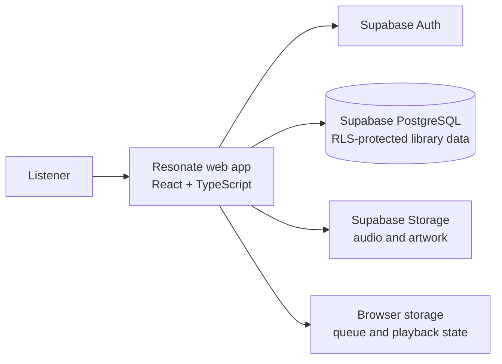

<div align="center">

# Resonate

### Your music library, built around the way you listen.

A cloud-backed music library and web player for uploading, organizing, discovering, and playing your personal music collection.

**React · TypeScript · Vite · Supabase**

</div>

---

## Contents

- [Overview](#overview)
- [Features](#features)
- [Technology](#technology)
- [Architecture](#architecture)
- [Getting started](#getting-started)
- [Configuration](#configuration)
- [Database and storage](#database-and-storage)
- [Available scripts](#available-scripts)
- [Keyboard shortcuts](#keyboard-shortcuts)
- [Deployment](#deployment)
- [Project structure](#project-structure)
- [Security and privacy](#security-and-privacy)
- [Troubleshooting](#troubleshooting)
- [Contributing](#contributing)

## Overview

Resonate is a responsive, browser-based music player backed by Supabase. Sign in to manage a personal library, upload supported audio files, create playlists, and listen with a persistent playback queue. Track metadata and library relationships live in Supabase; playback preferences and queue restoration also use the current browser.

The client communicates directly with Supabase using the public project URL and publishable/anon key. Authentication, PostgreSQL row-level security (RLS), database policies, and Storage policies provide the access boundaries—there is no separate application server in this repository.

## Features

### Library and uploads

- Upload MP3, WAV, OGG, FLAC, M4A, and AAC audio files.
- Extract available title, artist, album, genre, year, duration, and embedded artwork.
- Generate waveform data and an artwork-derived dominant color for compatible tracks.
- Browse the library in grid or list view; search, sort, filter, and load additional results.
- Edit track details, manage favorites, and remove tracks.
- Select multiple tracks for supported bulk actions.
- View the account's audio and artwork storage usage in Settings.

### Player and queue

- Play, pause, seek, skip tracks, mute, and adjust volume and playback speed.
- Shuffle playback and select repeat off, repeat all, or repeat one.
- Keep playback active while navigating between application pages.
- Restore supported player state, including the queue and playback position, after a browser refresh.
- View an audio-frequency visualizer and artwork-derived player colors.
- Add tracks to the queue, reorder or remove them, and save the queue as a playlist.

### Playlists and discovery

- Create, rename, duplicate, delete, import, and export playlists.
- Add one or more tracks and reorder tracks within a playlist.
- Search across songs, artists, albums, genres, and playlists.
- Explore generated library views: Favorites, Recently Played, Recently Added, Most Played, Never Played, Last Week, and Last Month.

### Preferences and usability

- Choose a dark or light theme and an accent color.
- Configure default volume, playback speed, autoplay, and track fade-out duration.
- Use keyboard shortcuts for common playback actions.
- Use responsive layouts across desktop, tablet, and mobile screen sizes.

## Technology

| Layer | Stack |
| --- | --- |
| User interface | React 18, TypeScript, Tailwind CSS, Lucide |
| Development and build | Vite |
| Client-side routing | React Router |
| Authentication | Supabase Auth |
| Database | Supabase PostgreSQL with row-level security |
| Object storage | Supabase Storage |
| Audio and metadata | HTML audio, Web Audio API, `jsmediatags` |

## Architecture



The browser uses the Supabase JavaScript client. PostgreSQL stores account-owned songs, playlists, favorites, play history, settings, and playlist ordering. Storage contains audio and artwork objects. The included SQL migrations configure the schema, grants, RLS policies, Storage buckets and policies, and the `record_play` RPC.

## Getting started

### Prerequisites

- Node.js 18 or newer and npm.
- A Supabase project.
- The Supabase Project URL and publishable key (or legacy `anon` key).

### 1. Install dependencies

From the project directory:

```bash
npm install
```

### 2. Configure Supabase

Copy `.env.example` to `.env` and set the values for your Supabase project:

```env
VITE_SUPABASE_URL=https://your-project-ref.supabase.co
VITE_SUPABASE_ANON_KEY=your-supabase-publishable-or-anon-key
```

Find these values in **Supabase Dashboard → Project Settings → API**. Restart the Vite server after changing environment variables.

> **Never use a Supabase `service_role` key in this application.** Variables prefixed with `VITE_` are compiled into client-side code and are visible to users.

### 3. Apply database migrations

Apply **all** SQL files in `supabase/migrations/` to the target project, in timestamp order:

1. `20260727102940_create_music_schema.sql`
2. `20260727103105_add_record_play_rpc.sql`
3. `20261109110000_grant_authenticated_music_access.sql`
4. `20261109113000_enforce_song_ownership_in_relations.sql`

For a new project, run each file in the Supabase SQL Editor in the order shown. Keep schema changes in versioned migrations so development and production environments can be reproduced consistently. The app expects the tables, policies, grants, RPC, and buckets configured by these migrations.

### 4. Start the development server

```bash
npm run dev
```

Open the local address printed by Vite. Create an account or sign in with email and password. If email confirmation is enabled in Supabase Auth, confirm the address before signing in.

## Configuration

| Variable | Required | Description |
| --- | --- | --- |
| `VITE_SUPABASE_URL` | Yes | Supabase project URL. |
| `VITE_SUPABASE_ANON_KEY` | Yes | Supabase publishable key or legacy anon key. It is public by design; database and storage policies must enforce access. |

The repository includes `.env.example` as a template. Do not commit `.env` or credentials.

## Database and storage

### Database entities

The migrations define the following primary tables:

| Table | Purpose |
| --- | --- |
| `songs` | Track metadata and audio/artwork object paths. |
| `playlists` | User-created playlist details. |
| `playlist_songs` | Ordered song membership for playlists. |
| `favorites` | User favorite-to-song relationships. |
| `play_history` | Recently played tracks and play counts. |
| `user_settings` | Per-account player and appearance preferences. |

The `record_play` database function records playback history for the authenticated account. RLS policies scope database access to the signed-in user and ensure related tracks belong to the correct owner.

### Storage buckets

The migrations configure two buckets:

- `audio` — uploaded audio files.
- `artwork` — track artwork.

Object names are organized by account, and authenticated write/update/delete policies restrict changes to an owner's objects.

> **Important: the migrations configure both buckets for public read access.** Anyone who obtains an object's public URL may be able to retrieve that audio or artwork. Database RLS protects library records, but it does not make these media objects private. Do not upload content that must remain confidential. A private-media deployment requires changing the bucket visibility and implementing authenticated or signed URL playback.

Supabase plan limits and project storage configuration determine actual capacity and bandwidth. The usage displayed by the app is an estimate based on the user's listed audio and artwork objects; it is not a quota reservation.

### Browser-local state

The browser stores playback and queue restoration data. Settings are cached per account in the browser and synchronized with that account's `user_settings` record. Browser storage is not a backup of cloud media or library records. Signing out clears the saved queue and current-track position for that browser.

Files in an older local-only library are not automatically migrated. Upload them again after signing in.

## Available scripts

| Command | Description |
| --- | --- |
| `npm run dev` | Start the local Vite development server. |
| `npm run typecheck` | Type-check the application with TypeScript. |
| `npm run lint` | Run ESLint across the project. |
| `npm run build` | Create the optimized production build in `dist/`. |
| `npm run preview` | Serve the production build locally; run `npm run build` first. |

## Keyboard shortcuts

| Key | Action |
| --- | --- |
| `Space` | Play or pause |
| `←` / `→` | Previous / next track |
| `↑` / `↓` | Increase / decrease volume |
| `M` | Mute / unmute |
| `S` | Toggle shuffle |
| `R` | Cycle repeat mode |

## Deployment

1. Configure the production build environment with `VITE_SUPABASE_URL` and `VITE_SUPABASE_ANON_KEY`.
2. Apply all migrations to the production Supabase project.
3. Build the application:

   ```bash
   npm run build
   ```

4. Deploy the contents of `dist/` to a static web host.
5. Configure the host to rewrite application routes to `index.html` (SPA fallback).
6. Add the deployed site URL to the Supabase Auth URL configuration and configure allowed redirect URLs as needed.
7. Verify sign-in, database access, and uploads against the production project.

Review the [Storage security note](#storage-buckets) before deploying for users or uploading media.

## Project structure

```text
src/
  components/       Shared interface, navigation, upload, queue, and player
    ui/             Reusable buttons, inputs, modals, and spinners
  context/          Authentication, player, settings, theme, and toast state
  hooks/            Favorites, keyboard shortcuts, infinite scroll, and debounce
  lib/              Supabase access, songs, playlists, audio, and utilities
  pages/            Authentication, library, search, playlists, smart views, settings
  types/            Shared TypeScript types
supabase/
  migrations/       Ordered schema, access, and policy migrations
```

## Security and privacy

- Keep Supabase RLS enabled and apply every migration to each environment.
- Use only the publishable/anon key in the browser; never expose a service-role key.
- Understand that the configured audio and artwork buckets are public-read.
- Keep `.env` out of version control and use your hosting provider's environment configuration for production builds.
- Review Supabase Auth settings, project quotas, and storage policies before inviting users.

## Troubleshooting

| Symptom | What to check |
| --- | --- |
| Supabase connection or configuration error | Verify both environment variables, ensure they refer to the intended project, and restart Vite after editing `.env`. |
| Database permission or missing-relation error | Apply all migrations in timestamp order; verify RLS policies and authenticated grants are present. |
| Upload failure | Check the supported audio type, Supabase bucket configuration and policies, project storage limits, and network connectivity. |
| Account creation does not sign in | Check whether email confirmation is enabled and verify the address if required. |
| A deployed deep link returns 404 | Configure the static host's SPA fallback to serve `index.html`. |
| Production authentication redirect fails | Add the deployed origin and redirect URLs to the Supabase Auth URL configuration. |

## Contributing

1. Create a focused change and follow the existing TypeScript and React patterns.
2. Record database changes in a new timestamped migration; do not rely on undocumented dashboard-only schema edits.
3. Run the project checks before submitting:

   ```bash
   npm run typecheck
   npm run lint
   npm run build
   ```

---

<div align="center">

Built with React, TypeScript, and Supabase.

</div>
